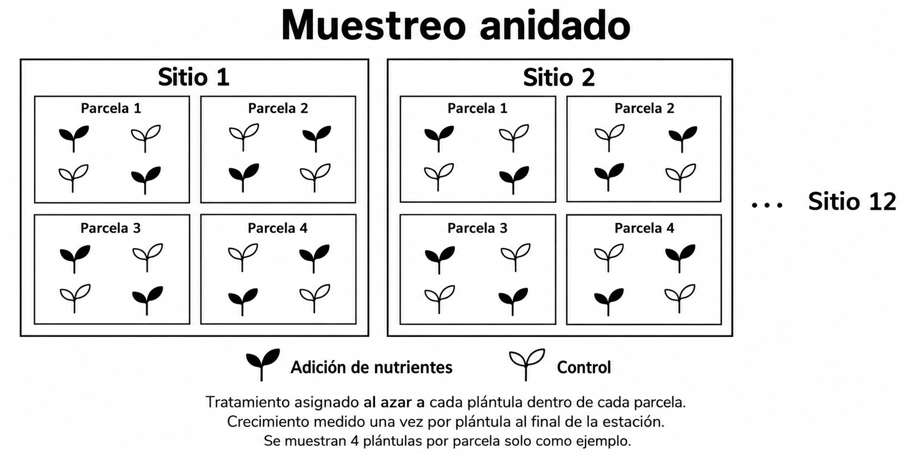
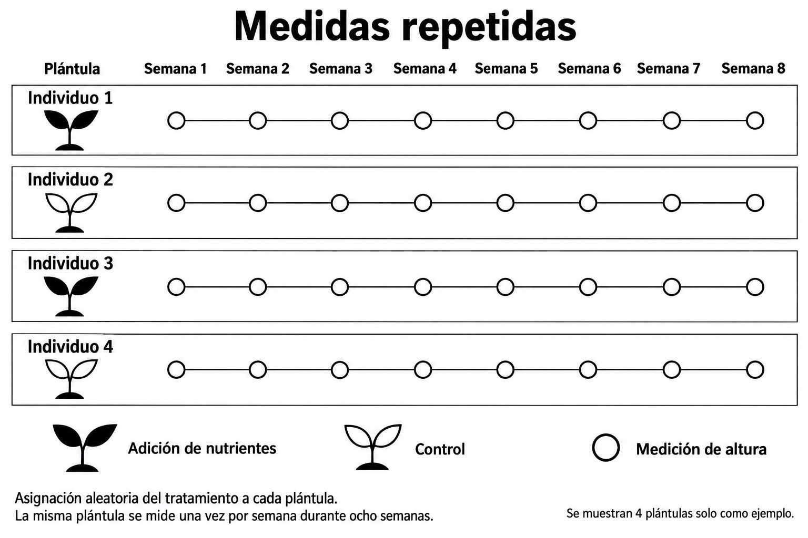
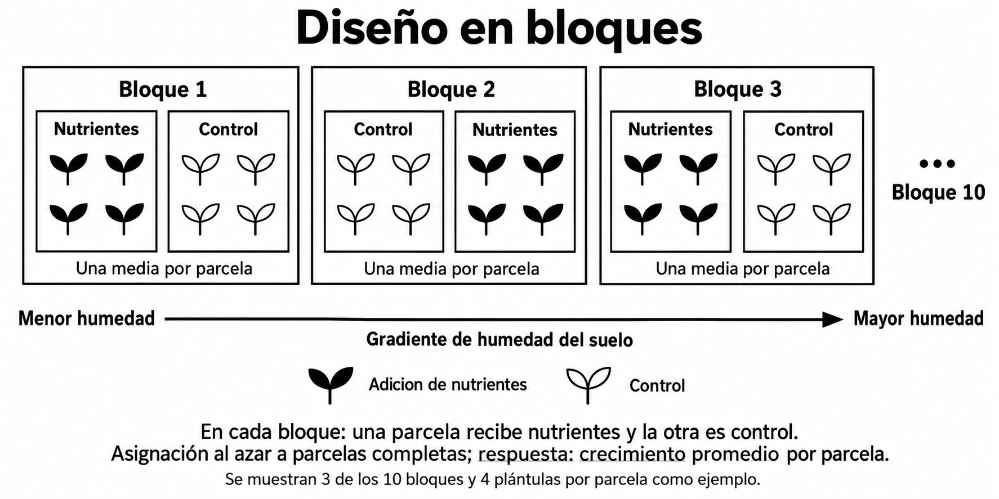
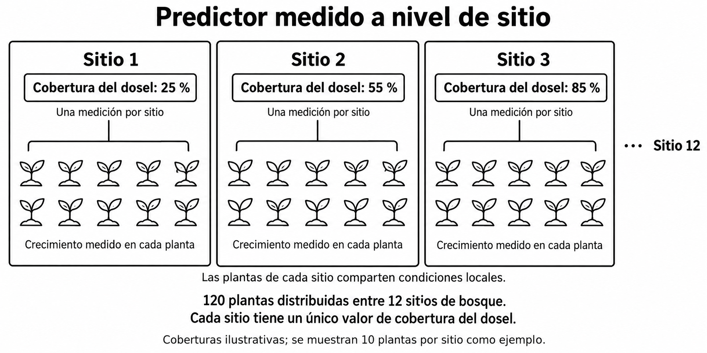
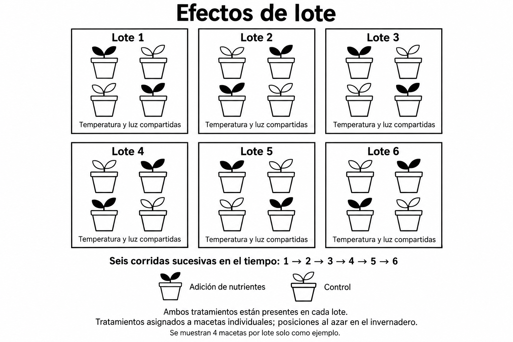

```{=latex}
\vspace{-6em}
```

## Introducción

En esta actividad, analizaremos diseños ecológicos para decidir cuándo una
estructura de agrupamiento puede requerir efectos aleatorios. En cada caso,
consideren qué observaciones comparten condiciones, cuál es la unidad
experimental o de muestreo y qué efecto se desea estimar.

Un efecto aleatorio cumple dos funciones que conviene distinguir. Cuando la
cantidad a estimar compara **entre** grupos (por ejemplo, un predictor medido a
nivel de sitio), el efecto aleatorio evita tratar las observaciones de un mismo
grupo como réplicas independientes (pseudorreplicación). Cuando la cantidad a
estimar compara **dentro** de los grupos (por ejemplo, tratamiento y control
dentro de cada bloque), el efecto aleatorio separa la variación entre grupos del
error residual y aumenta la precisión de la comparación.

```{=latex}
\footnotesize
```

::: {.callout-note title="Actividad: estaciones de aprendizaje"}

- **Grupos de hasta 4 personas.** Cada grupo recibe esta introducción, la tabla
  de referencia y la hoja de trabajo.
- **Estaciones:** cada uno de los cuatro casos está impreso en dos estaciones
  alrededor del aula (ocho estaciones en total). Dos grupos pueden trabajar el
  mismo caso al mismo tiempo en estaciones distintas.
- **Rotación [5–6 minutos por estación]:** en cada estación, lean el caso,
  discutan las preguntas de "Conversen" y completen la fila correspondiente de la
  tabla. Al terminar, roten a una estación con un caso que no hayan visto.
- **Cierre en grupo [10 minutos]:** con los cuatro casos completos, respondan las
  tres preguntas de discusión de la hoja de trabajo.
- **Puesta en común [10–15 minutos]:** cada grupo presenta un caso; los demás
  comparan con sus respuestas.
- **Bitácora (individual):** la última página presenta un caso nuevo. Resuélvanlo
  individualmente en la bitácora aplicando lo discutido; esa es la entrada
  calificada.

:::

::: {.callout-note title="Sintaxis de efectos aleatorios en R"}

Los efectos aleatorios se escriben entre paréntesis dentro de la fórmula. A la
izquierda de `|` va lo que varía entre grupos; a la derecha, la variable de
agrupamiento. El `1` representa el intercepto.

- `y ~ x + (1 | grupo)` — **intercepto aleatorio**: cada nivel de `grupo` tiene
  su propio intercepto (su propia línea base). La pendiente de `x` es la misma
  para todos los grupos.
- `y ~ x + (1 + x | grupo)` — **intercepto y pendiente aleatorios**: cada grupo
  tiene su propio intercepto y su propia pendiente de `x`.
- `y ~ x + (1 | a/b)` — **agrupamiento anidado**: `b` está dentro de `a`.
  Equivale a `(1 | a) + (1 | a:b)`: un intercepto por cada nivel de `a` y otro
  por cada `b` dentro de cada `a`. El orden importa: `a/b` no es lo mismo que
  `b/a`.

:::

::: {.callout-important title="Paquetes necesarios"}

Los modelos con efectos aleatorios (modelos mixtos) no se ajustan con `lm()` ni
`glm()`. Se necesitan paquetes como `lme4` (funciones `lmer()` y `glmer()`) o
`glmmTMB` (función `glmmTMB()`), que ya usamos para datos de conteo. Ambos
aceptan la misma sintaxis de efectos aleatorios.

:::

```{=latex}
\normalsize
\clearpage
```

```{=html}
<div style="break-before: page; page-break-before: always;"></div>
```

## Referencia: efectos fijos y efectos aleatorios

| Característica | Efectos fijos | Efectos aleatorios |
|---|---|---|
| Selección de grupos | Los grupos específicos son de interés directo (por ejemplo, comparar tratamiento y control, o machos y hembras). | Los grupos son una muestra aleatoria de una población más amplia (por ejemplo, 20 ranas de una población de miles). |
| Objetivo | Estimar el tamaño del efecto para cada grupo específico. | Estimar y controlar la variación entre grupos. |
| Tamaño de muestra | Puede funcionar con pocos grupos, pero requiere suficientes datos dentro de cada grupo. | Requiere un mayor número de grupos (por lo general, entre 5 y 10 o más) para estimar la varianza con precisión. |
| Interpretación | Se enfoca en los niveles específicos del factor incluidos en el modelo. | Se enfoca en la variabilidad entre los niveles del factor, más que en cada nivel específico. |
| Predictor medido a nivel de grupo | No es posible: el factor fijo de grupo es colineal con el predictor y el efecto de este no se puede estimar. | Permite estimar el efecto del predictor y, a la vez, representar la dependencia entre observaciones del mismo grupo. |

```{=latex}
\clearpage
```

```{=html}
<div style="break-before: page; page-break-before: always;"></div>
```

## Caso 1. Muestreo anidado

Un equipo de investigación selecciona 12 sitios de bosque de una región. En cada
sitio selecciona cuatro parcelas. Dentro de cada parcela asigna al azar la mitad
de las plántulas a un tratamiento de adición de nutrientes y la otra mitad a un
control. Mide la altura de cada plántula al inicio y al final de la estación de
crecimiento; el crecimiento de cada plántula es la diferencia entre ambas
medidas, un solo valor por plántula.

**Predicción:** La adición de nutrientes aumenta el crecimiento de las
plántulas.

**Cantidad a estimar:** La diferencia promedio en crecimiento entre
plántulas tratadas y controles en la población de sitios y parcelas representada
por la muestra.

**Conversen:** ¿Qué plántulas comparten condiciones? ¿En qué niveles se asignó el
tratamiento y se midió la respuesta?




```{=latex}
\clearpage
```

```{=html}
<div style="break-before: page; page-break-before: always;"></div>
```

## Caso 2. Medidas repetidas

Un equipo asigna al azar 30 plántulas individuales a adición de nutrientes o
control (15 por tratamiento). Mide la altura de cada plántula una vez por semana
durante ocho semanas. La tasa de crecimiento de una plántula es la pendiente de
su altura en función de la semana.

**Predicción:** La adición de nutrientes aumenta la tasa de crecimiento
en altura.

**Cantidad a estimar:** La diferencia entre tratamientos en la tasa
promedio de crecimiento, expresada en centímetros por semana.

**Conversen:** ¿Qué observaciones provienen del mismo individuo? ¿Podrían las
plántulas diferir en su altura inicial o en su tasa de crecimiento? ¿Qué término
del modelo evaluaría la diferencia en tasa entre tratamientos?



```{=latex}
\clearpage
```

```{=html}
<div style="break-before: page; page-break-before: always;"></div>
```

## Caso 3. Diseño en bloques

Un equipo establece 10 bloques a lo largo de un gradiente de humedad del suelo.
Cada bloque contiene dos parcelas experimentales. Asigna al azar una parcela de
cada bloque a la adición de nutrientes y la otra al control. Mide el crecimiento
promedio de las plántulas en cada parcela.

**Predicción:** La adición de nutrientes aumenta el crecimiento, luego
de tomar en cuenta las diferencias de base entre bloques (humedad del suelo y
otras condiciones locales).

**Cantidad a estimar:** La diferencia promedio entre las parcelas
tratadas y controles dentro de bloques comparables.

**Conversen:** ¿Por qué comparar parcelas dentro del mismo bloque? ¿Qué
observaciones comparten condiciones de humedad?



```{=latex}
\clearpage
```

```{=html}
<div style="break-before: page; page-break-before: always;"></div>
```

## Caso 4. Predictor medido a nivel de sitio

Un equipo mide el crecimiento de 120 plantas distribuidas entre 12 sitios de
bosque. Mide la cobertura del dosel una vez por sitio, por lo que todas las
plantas de un sitio tienen el mismo valor de cobertura. Las plantas de un sitio
también comparten suelo, clima y otras condiciones locales. Mide la altura de
cada planta al inicio y al final de la estación de crecimiento. Para cada planta,
calcula un solo valor de crecimiento como la diferencia entre ambas mediciones.

**Predicción:** El crecimiento de las plantas cambia con la cobertura
del dosel.

**Cantidad a estimar:** La pendiente que relaciona la cobertura del dosel con el
crecimiento promedio de las plantas entre los sitios de bosque de la región.

**Conversen:** ¿A qué nivel varía la cobertura del dosel? ¿La información
independiente para estimar su relación con el crecimiento proviene principalmente
de las 120 plantas o de los 12 sitios? ¿Qué agrupamiento debería representar el
modelo?



```{=latex}
\clearpage
```

```{=html}
<div style="break-before: page; page-break-before: always;"></div>
```

# Hoja de trabajo grupal

## Análisis de los casos

Para cada caso, identifiquen la unidad experimental o de muestreo, indiquen qué
observaciones podrían ser dependientes y propongan las variables de agrupamiento
que incluirían como efectos aleatorios, si corresponde. Justifiquen su decisión
en relación con la predicción.

::: {.content-visible when-format="pdf"}

```{=latex}
\renewcommand{\arraystretch}{1.2}
\begin{tabular}{|>{\raggedright\arraybackslash}p{0.20\textwidth}|>{\raggedright\arraybackslash}p{0.23\textwidth}|>{\raggedright\arraybackslash}p{0.23\textwidth}|>{\raggedright\arraybackslash}p{0.23\textwidth}|}
\hline
\textbf{Caso} & \textbf{Unidad experimental o de muestreo} & \textbf{¿Qué observaciones comparten condiciones o individuo?} & \textbf{Efecto(s) aleatorio(s) propuesto(s) y justificación} \\
\hline
1. Muestreo anidado & & & \\[7em]
\hline
2. Medidas repetidas & & & \\[7em]
\hline
3. Diseño en bloques & & & \\[7em]
\hline
4. Predictor a nivel de sitio & & & \\[7em]
\hline
\end{tabular}
\renewcommand{\arraystretch}{1}
```

:::

::: {.content-visible unless-format="pdf"}

| Caso | Unidad experimental o de muestreo | ¿Qué observaciones comparten condiciones o individuo? | Efecto(s) aleatorio(s) propuesto(s) y justificación |
|:---|:---|:---|:---|
| 1. Muestreo anidado |  |  |  |
| 2. Medidas repetidas |  |  |  |
| 3. Diseño en bloques |  |  |  |
| 4. Predictor a nivel de sitio |  |  |  |

:::

```{=latex}
\clearpage
```

```{=html}
<div style="break-before: page; page-break-before: always;"></div>
```

## Preguntas de discusión

**1. En diseños anidados, ¿cuáles observaciones comparten condiciones ambientales o corresponden al mismo individuo? ¿Cuál(es) variable(s) de agrupamiento representan esas fuentes de dependencia?**

::: {.answer-space lines=3}
:::

**2. En el caso de medidas repetidas, ¿cuál término del modelo permite evaluar si el tratamiento cambia la tasa de crecimiento?**

::: {.answer-space lines=3}
:::

**3. En cada caso, ¿la cantidad a estimar compara observaciones *dentro* de los grupos o *entre* grupos? Si se omitiera el agrupamiento, ¿la incertidumbre del efecto estimado sería demasiado grande o demasiado pequeña? ¿Por qué?**

::: {.answer-space lines=4}
:::

```{=latex}
\clearpage
```

```{=html}
<div style="break-before: page; page-break-before: always;"></div>
```

# Entrada de bitácora (individual)

Apliquen lo discutido en la actividad a un diseño nuevo. Respondan en su
bitácora, de forma individual.

## Caso para la bitácora. Efectos de lote

Un equipo cultiva plántulas en macetas individuales y asigna al azar los
tratamientos de nutrientes (adición o control) a cada maceta. Debido a
limitaciones de espacio, debe realizar el experimento en seis lotes sucesivos en
el mismo invernadero. Cada lote incluye 20 macetas, 10 por tratamiento, asignadas
al azar a posiciones del invernadero. Las condiciones de temperatura y luz
podrían variar un poco entre lotes. Mide la altura de cada plántula al inicio y
al final de su lote; el crecimiento es la diferencia entre ambas medidas.

**Predicción:** La adición de nutrientes aumenta el crecimiento, a pesar de la
variación en las condiciones entre lotes.

**Cantidad a estimar:** El efecto promedio del tratamiento entre los lotes
representados por el experimento.

{width=75%}

**Preguntas:**

1. ¿Cuál es la unidad experimental? ¿Qué observaciones comparten condiciones?
2. ¿Qué variable(s) incluiría como efecto aleatorio y por qué? Escriba el modelo
   con la sintaxis de R de la página 1.
3. ¿A cuál de los cuatro casos de la actividad se parece más este diseño? ¿En qué
   se diferencia?
4. ¿El tratamiento se compara *dentro* o *entre* lotes? Si se omitiera el lote
   del modelo, ¿la incertidumbre del efecto del tratamiento sería demasiado
   grande o demasiado pequeña? ¿Por qué es importante que cada lote incluya
   ambos tratamientos?
